# Modelo de datos propuesto — borrador inicial

## Alcance

Este borrador traduce el relevamiento de Microsoft Access a un modelo conceptual nuevo. No es todavía un esquema físico ni una migración. Se basa en evidencia confirmada de tablas, relaciones y formularios, y marca las decisiones que todavía requieren validación operativa.

El objetivo es soportar campañas de vacunación antiaftosa, conservar el componente de brucelosis en terneras cuando corresponda, controlar stock por lote y mantener historia auditable.

## Núcleo recomendado

| Área | Tabla propuesta | Responsabilidad principal |
|---|---|---|
| Campañas | `campanias` | Año, tipo total/parcial, fechas, estado y reglas de población objetivo. |
| Campañas | `periodos_campania` | Semanas o cortes administrativos propios de una campaña. |
| Campañas | `campania_centros` | Centros participantes, vigencia, responsable y capacidades operativas habilitadas. |
| Campañas | `campania_categorias` | Categorías previstas, obligatoriedad, orden y regla de cobertura. |
| Campañas | `reglas_campania` | Parámetros versionados de actas, demoras, excepciones y cierre. |
| Campañas | `versiones_configuracion_campania` | Instantánea, motivo, usuario y fecha de cada configuración preparada o activa. |
| Personas | `clientes_productores` | Identidad canónica e identificador interno; documento, contacto y datos comerciales son completables y no condicionan la operación sanitaria. |
| Personas | `contactos_cliente_productor` | Teléfonos, correos y otros contactos privados, con tipo, preferencia, verificación y vigencia. |
| Personas | `alias_cliente_productor` | Nombres originales, anteriores o alternativos conservados para reconocer importaciones y evitar duplicados. |
| Personas | `unificaciones_cliente_productor` | Identidades origen y destino, motivo, autorización y fecha de cada unificación auditable. |
| Personas | `revisiones_alta_interna` | Estado de revisión, datos pendientes, responsable, notas y fecha de cada avance sin afectar la disponibilidad operativa. |
| Personas | `coincidencias_cliente_productor` | Candidatos, criterios, puntaje informativo y decisión humana de confirmar, descartar o mantener pendiente. |
| Personas | `importaciones_clientes` | Archivo comercial, fecha, fuente, versión, hash, responsable y resultado de cada importación de clientes. |
| Personas | `filas_importacion_clientes` | Valores originales y normalizados por fila, estado de comparación e identidad resultante. |
| Personas | `codigos_externos_cliente` | Códigos provenientes de sistemas comerciales, con fuente y vigencia; pueden proponer un RENSPA sin reemplazarlo. |
| Predios | `establecimientos` | Identificador interno; RENSPA, nombre, ubicación y atributos estables del predio pueden quedar pendientes. |
| Predios | `productor_establecimiento` | Rol o régimen del productor en el predio y su vigencia. |
| Predios | `explotaciones_establecimiento` | Actividades como cría, tambo o invernada, con vigencia. |
| Existencias | `existencias` | Cabecera de una declaración o fotografía de rodeo por fecha, campaña y fuente. |
| Existencias | `existencias_detalle` | Cantidad por categoría animal. |
| Catálogos | `categorias_animales` | Vacas, vaquillonas, terneros, terneras, búfalos, etc. |
| Organización | `unidades_ejecutoras` | UEL responsable de stock, distribución y actas. |
| Organización | `centros_stock` | Sede principal y subcentros dependientes, con localidad, responsable y jerarquía. |
| Organización | `centro_veterinaria` | Veterinarias que operan en cada centro, con vigencia; admite varias por subcentro. |
| Personas | `vacunadores` | Persona habilitada, matrícula, tipo veterinario/idóneo y vigencia. |
| Personas | `contactos_vacunador` | Teléfonos y otros contactos, valor normalizado, preferencia, vigencia y autorización para avisos operativos. |
| Organización | `veterinarias` | Veterinaria o punto operativo asociado al acta. |
| Organización | `contactos_veterinaria` | Teléfonos, correos y otros contactos privados, con valor normalizado, preferencia, verificación y vigencia. |
| Organización | `directores_tecnicos_veterinaria` | Director técnico, documento, matrícula, habilitación y vigencia para cada veterinaria. |
| Organización | `autoridades_institucionales` | Presidente, secretario, responsables SENASA y otros cargos, con identidad y vigencia histórica. |
| Comercial | `empresas` | Empresa láctea, cooperativa u organización receptora. |
| Comercial | `establecimiento_empresa` | Relación comercial del establecimiento con vigencia. |
| Facturación | `tarifas_campania` | Dos importes por animal —veterinario e idóneo—, moneda, concepto, aprobación, vigencia y versión congelada para cada campaña. |
| Facturación | `lineas_facturables_acta` | Acta y versión, cliente, profesional efectivo, tipo, cantidad de animales, tarifa aplicada, subtotal y estado comercial. |
| Facturación | `liquidaciones_facturacion` | Agrupación revisable de líneas compatibles por cliente, campaña, moneda y tratamiento fiscal. |
| Facturación | `liquidaciones_facturacion_detalle` | Líneas de acta incluidas en cada liquidación y su instantánea económica. |
| Facturación | `facturas` | Comprobante emitido o referencia al sistema externo, numeración, importes, estado y autorización fiscal futura. |
| Facturación | `facturas_detalle` | Conceptos y vínculo con las líneas/liquidaciones que originaron el comprobante. |
| Facturación | `ajustes_facturacion` | Diferencias originadas por rectificación o anulación, con nota de crédito/débito asociada. |
| Cajas | `cajas` | Caja física o lógica, centro, moneda, medios habilitados, cuenta de destino y vigencia. |
| Cajas | `caja_usuarios` | Usuarios autorizados para una caja, vigencia y permisos específicos. |
| Cajas | `sesiones_caja` | Apertura, saldo inicial, usuario, turno, estados de cierre y rendición. |
| Cajas | `cobros` | Cliente, recibo, importe total, usuario, sesión y estado inmutable/revertido. |
| Cajas | `cobros_medios` | Efectivo, transferencia, tarjeta, cheque u otro medio que integra un cobro. |
| Cajas | `imputaciones_cobro` | Aplicación total o parcial de un cobro a una o varias facturas del mismo cliente. |
| Cajas | `movimientos_caja` | Ingresos, egresos, cobros y reversiones que explican el saldo esperado. |
| Cajas | `cierres_caja` | Totales esperados, valores declarados, diferencia, observación y usuario de cierre. |
| Cajas | `rendiciones_caja` | Control del supervisor, recepción de valores, comprobantes y resolución de diferencias. |
| Vacunas | `laboratorios` | Fabricante o laboratorio. |
| Vacunas | `productos_vacuna` | Vacuna antiaftosa, marca y fabricante; queda preparado para futuros productos. |
| Vacunas | `lotes_vacuna` | Serie/lote, vencimiento, producto y estado. |
| Stock | `ubicaciones_stock` | UEL o profesional que mantiene la custodia física. |
| Stock | `recepciones_stock` | Cabecera de cada tanda recibida en San Cristóbal, con fecha/hora, comprobante y responsables. |
| Stock | `recepciones_stock_detalle` | Lotes, vencimientos, frascos, temperatura, sensores y estado inicial sin asignar. |
| Stock | `asignaciones_stock` | Asignación o reasignación autorizada de existencias a una veterinaria. |
| Stock | `transferencias_stock` | Traslados internos entre sede principal y subcentros. |
| Stock | `transferencias_stock_detalle` | Veterinaria, lote, condición y cantidades trasladadas. |
| Stock | `recepciones_transferencia` | Control de destino, fecha/hora, temperatura, responsable, usuario, estado y versión recibida. |
| Stock | `recepciones_transferencia_detalle` | Cantidades enviadas y comprobadas, lote, vencimiento, integridad y diferencias por línea. |
| Stock | `incidencias_transferencia` | Diferencias informadas, evidencia, resolución, autorización y movimientos correctivos. |
| Stock | `stock_veterinaria` | Saldos separados por centro, veterinaria o estado sin asignar, lote y condición. |
| Stock | `movimientos_stock` | Recepción, transferencia, devolución, consumo, rotura/decomiso en UEL o ajuste. |
| Stock | `movimientos_stock_detalle` | Veterinaria propietaria, lote, cantidad de frascos o remanente y condición. |
| Stock | `remitos_retiro` | Centro físico de salida, veterinaria propietaria, autorización, entrega y firma del profesional receptor. |
| Stock | `remitos_retiro_detalle` | Origen lleno/sobrante, serie/lote, frascos o dosis entregadas. |
| Stock | `remito_destinos` | Uno o más clientes/productores y establecimientos previstos para utilizar la vacuna de un remito. |
| Stock | `versiones_remito` | Instantánea de cada emisión o modificación, con número de versión, motivo y estado de firma. |
| Stock | `impresiones_remito` | Fecha, usuario, versión impresa y reimpresiones del comprobante. |
| Stock | `devoluciones_remito` | Cabecera de cada devolución parcial vinculada al retiro, con fecha y receptor UEL. |
| Stock | `devoluciones_remito_detalle` | Frascos llenos o dosis sobrantes reales por lote, acta y productor de origen. |
| Stock | `sobrantes_vacuna` | Remanente abierto por veterinaria, lote, productor, establecimiento y acta. |
| Stock | `conciliaciones_remito` | Retirado, vacunado, devolución esperada/real, uso inferido, variaciones y estado de cierre. |
| Documentos | `series_acta` | Secuencias y rangos autorizados para numerar formularios. |
| Documentos | `lotes_impresion_acta` | Emisión de juegos numerados y control de rangos impresos. |
| Documentos | `formularios_acta` | Papel numerado, datos preimpresos, asignación y estado documental. |
| Documentos | `impresiones_acta` | Original, duplicado, triplicado y reimpresiones. |
| Documentos | `eventos_formulario_acta` | Entrega, devolución, extravío, anulación y demás trazabilidad física. |
| Documentos | `alertas_formulario_acta` | Alertas preventivas y críticas por demora, fecha de emisión, atención y próxima repetición. |
| Documentos | `seguimientos_acta` | Gestión de contacto por vacunador, canal, resultado, nota y próxima fecha. |
| Documentos | `seguimiento_formularios` | Formularios incluidos en cada gestión; permite reclamar varias actas en una llamada o mensaje. |
| Documentos | `autorizaciones_preimpresion` | Excepciones limitadas al bloqueo, con vacunador, remito, cantidad, motivo, vigencia y autorizante. |
| Documentos | `plantillas_senasa` | Tipo, versión, vigencia y archivo base de cada acta o planilla oficial. |
| Documentos | `impresiones_senasa` | Documento generado, campaña, plantilla, fecha, usuario y registros de origen. |
| Documentos | `plantillas_convenio` | Versión aprobada del texto legal, archivo fuente, vigencia, referencias normativas y hash. |
| Documentos | `convenios_campania_veterinaria` | Convenio por campaña y veterinaria, estado, datos congelados, versión generada y fecha de firma. |
| Documentos | `firmantes_convenio` | Firmantes y datos impresos por rol, conservados como instantánea de cada versión. |
| Documentos | `impresiones_convenio` | Versión impresa, usuario, fecha, cantidad de ejemplares, motivo y reimpresiones. |
| Documentos | `eventos_convenio` | Preparación, generación, impresión, firma física, archivo, reemplazo y anulación. |
| Documentos | `alertas_convenio` | Aviso no bloqueante por firma o archivo pendiente, atención, observación y resolución. |
| Documentos | `archivos_convenio` | Copias digitales firmadas, páginas, ejemplar de referencia, formato, hash, vigencia, observación y reemplazo. |
| Vacunación | `actas_vacunacion` | Cabecera: campaña, establecimiento, fecha, número, UEL, vacunador y estado. |
| Vacunación | `aplicaciones_acta` | Programa/enfermedad, resultado o razón y cantidades de la intervención. |
| Vacunación | `aplicaciones_detalle` | Categoría animal, animales vacunados, lote y dosis utilizadas. |
| Vacunación | `rectificaciones_acta` | Correcciones posteriores a la confirmación y sus efectos auditados. |
| Padrón | `importaciones_padron` | Fuente, fecha, campaña, archivo y responsable de una importación SENASA. |
| Padrón | `archivos_importacion_padron` | Original inmutable, nombre, formato, tamaño, hash y metadatos de recepción. |
| Padrón | `mapeos_importacion_padron` | Correspondencia entre cada encabezado de origen y el campo interno utilizado. |
| Padrón | `perfiles_importacion_padron` | Configuraciones de mapeo reutilizables, con versión y vigencia. |
| Padrón | `padron_importado` | Filas originales de cada importación. |
| Padrón | `incidencias_importacion_padron` | Error o advertencia por fila y columna, valor original, severidad y resolución. |
| Padrón | `controles_importacion_padron` | Totales declarados por hoja/libro y resultados de conciliación, sin tratarlos como filas de UP. |
| Padrón | `vinculos_padron_cliente` | Correspondencia trazable, opcional mientras no exista evidencia suficiente, entre una fila SENASA y el cliente/productor canónico. |
| Padrón | `padron_campania` | Población esperada conciliada para una campaña. |
| Sanidad | `eventos_sanitarios` | Evento de muestreo o control, enfermedad, establecimiento y profesional. |
| Sanidad | `protocolos_laboratorio` | Laboratorio, protocolo, muestras y estado. |
| Sanidad | `resultados_laboratorio` | Resultado por prueba o muestra. |
| Geografía | `provincias`, `departamentos`, `localidades` | Jerarquía territorial normalizada con códigos históricos. |
| Auditoría | `auditoria_cambios` | Cabecera inmutable: usuario, fecha del servidor, alcance efectivo, módulo, acción, resultado, entidad, registro y motivo. |
| Auditoría | `auditoria_cambios_detalle` | Campo afectado y valores anterior/nuevo de cada evento, con protección de datos sensibles. |
| Auditoría | `auditoria_relaciones` | Vínculo entre un evento y la operación anterior que corrige, revierte o aprueba. |
| Auditoría | `auditoria_exportaciones` | Filtros, formato, usuario, fecha y resultado de cada descarga autorizada. |
| Seguridad | `usuarios` | Identidad de acceso, estado y datos mínimos de autenticación. |
| Seguridad | `roles` y `permisos` | Plantillas y catálogo de acciones autorizables, con denegación por defecto. |
| Seguridad | `usuario_roles` | Roles asignados a cada usuario, vigencia y administrador que los autorizó. |
| Seguridad | `rol_permisos` | Acciones incluidas por defecto en cada plantilla de rol. |
| Seguridad | `usuario_permisos` | Concesiones o denegaciones particulares, vigencia, motivo y autorizante. |
| Seguridad | `usuario_campania` | Alcance del coordinador por campaña, UEL, vigencia y permisos adicionales. |
| Seguridad | `usuario_centro` | Centros de stock accesibles por cada usuario, vigencia y permisos locales. |
| Seguridad | `eventos_acceso_usuario` | Alta, invitación, activación, suspensión, acceso y cambios críticos conservados para auditoría privada. |

## Relación central

```mermaid
erDiagram
    CAMPANIAS ||--o{ ACTAS_VACUNACION : organiza
    CAMPANIAS ||--o{ PERIODOS_CAMPANIA : divide
    CAMPANIAS ||--|{ CAMPANIA_CENTROS : habilita
    CENTROS_STOCK ||--o{ CAMPANIA_CENTROS : participa
    CAMPANIAS ||--|{ CAMPANIA_CATEGORIAS : configura
    CATEGORIAS_ANIMALES ||--o{ CAMPANIA_CATEGORIAS : referencia
    CAMPANIAS ||--|{ REGLAS_CAMPANIA : versiona
    CAMPANIAS ||--|{ VERSIONES_CONFIGURACION_CAMPANIA : conserva
    ESTABLECIMIENTOS ||--o{ ACTAS_VACUNACION : recibe
    UNIDADES_EJECUTORAS ||--o{ ACTAS_VACUNACION : gestiona
    VACUNADORES ||--o{ ACTAS_VACUNACION : realiza
    VACUNADORES ||--o{ CONTACTOS_VACUNADOR : posee
    FORMULARIOS_ACTA ||--o| ACTAS_VACUNACION : origina
    FORMULARIOS_ACTA ||--o{ IMPRESIONES_ACTA : genera
    FORMULARIOS_ACTA ||--o{ EVENTOS_FORMULARIO_ACTA : registra
    FORMULARIOS_ACTA ||--o{ ALERTAS_FORMULARIO_ACTA : alerta
    FORMULARIOS_ACTA ||--o{ SEGUIMIENTO_FORMULARIOS : incluye
    SEGUIMIENTOS_ACTA ||--|{ SEGUIMIENTO_FORMULARIOS : agrupa
    VACUNADORES ||--o{ SEGUIMIENTOS_ACTA : contacta
    VACUNADORES ||--o{ AUTORIZACIONES_PREIMPRESION : recibe
    VETERINARIAS ||--o{ ACTAS_VACUNACION : interviene
    VETERINARIAS ||--o{ CONTACTOS_VETERINARIA : posee
    VETERINARIAS ||--o{ DIRECTORES_TECNICOS_VETERINARIA : designa
    UNIDADES_EJECUTORAS ||--o{ AUTORIDADES_INSTITUCIONALES : representa
    CAMPANIAS ||--o{ CONVENIOS_CAMPANIA_VETERINARIA : exige
    VETERINARIAS ||--o{ CONVENIOS_CAMPANIA_VETERINARIA : suscribe
    PLANTILLAS_CONVENIO ||--o{ CONVENIOS_CAMPANIA_VETERINARIA : versiona
    CONVENIOS_CAMPANIA_VETERINARIA ||--|{ FIRMANTES_CONVENIO : identifica
    CONVENIOS_CAMPANIA_VETERINARIA ||--o{ IMPRESIONES_CONVENIO : imprime
    CONVENIOS_CAMPANIA_VETERINARIA ||--o{ EVENTOS_CONVENIO : registra
    CONVENIOS_CAMPANIA_VETERINARIA ||--o{ ALERTAS_CONVENIO : alerta
    CONVENIOS_CAMPANIA_VETERINARIA ||--o{ ARCHIVOS_CONVENIO : digitaliza
    ACTAS_VACUNACION ||--o{ APLICACIONES_ACTA : contiene
    APLICACIONES_ACTA ||--o{ APLICACIONES_DETALLE : detalla
    CATEGORIAS_ANIMALES ||--o{ APLICACIONES_DETALLE : clasifica
    LOTES_VACUNA ||--o{ APLICACIONES_DETALLE : utiliza
    CAMPANIAS ||--|{ TARIFAS_CAMPANIA : define
    ACTAS_VACUNACION ||--o{ LINEAS_FACTURABLES_ACTA : origina
    TARIFAS_CAMPANIA ||--o{ LINEAS_FACTURABLES_ACTA : valora
    CLIENTES_PRODUCTORES ||--o{ LINEAS_FACTURABLES_ACTA : paga
    LIQUIDACIONES_FACTURACION ||--|{ LIQUIDACIONES_FACTURACION_DETALLE : agrupa
    LINEAS_FACTURABLES_ACTA ||--o| LIQUIDACIONES_FACTURACION_DETALLE : incluye
    LIQUIDACIONES_FACTURACION ||--o{ FACTURAS : emite
    FACTURAS ||--|{ FACTURAS_DETALLE : detalla
    FACTURAS ||--o{ AJUSTES_FACTURACION : ajusta
    CENTROS_STOCK ||--o{ CAJAS : ubica
    CAJAS ||--o{ CAJA_USUARIOS : autoriza
    USUARIOS ||--o{ CAJA_USUARIOS : opera
    CAJAS ||--o{ SESIONES_CAJA : abre
    USUARIOS ||--o{ SESIONES_CAJA : atiende
    SESIONES_CAJA ||--o{ COBROS : registra
    COBROS ||--|{ COBROS_MEDIOS : compone
    COBROS ||--|{ IMPUTACIONES_COBRO : aplica
    FACTURAS ||--o{ IMPUTACIONES_COBRO : recibe
    SESIONES_CAJA ||--o{ MOVIMIENTOS_CAJA : explica
    SESIONES_CAJA ||--o| CIERRES_CAJA : cierra
    CIERRES_CAJA ||--o| RENDICIONES_CAJA : rinde
    USUARIOS ||--o{ USUARIO_ROLES : recibe
    ROLES ||--o{ USUARIO_ROLES : asigna
    ROLES ||--o{ ROL_PERMISOS : incluye
    PERMISOS ||--o{ ROL_PERMISOS : habilita
    USUARIOS ||--o{ USUARIO_PERMISOS : particulariza
    PERMISOS ||--o{ USUARIO_PERMISOS : concede
    USUARIOS ||--o{ USUARIO_CAMPANIA : limita
    CAMPANIAS ||--o{ USUARIO_CAMPANIA : habilita
    USUARIOS ||--o{ USUARIO_CENTRO : limita
    CENTROS_STOCK ||--o{ USUARIO_CENTRO : habilita
    USUARIOS ||--o{ EVENTOS_ACCESO_USUARIO : audita
    USUARIOS ||--o{ AUDITORIA_CAMBIOS : ejecuta
    AUDITORIA_CAMBIOS ||--|{ AUDITORIA_CAMBIOS_DETALLE : detalla
    AUDITORIA_CAMBIOS ||--o{ AUDITORIA_RELACIONES : vincula
    USUARIOS ||--o{ AUDITORIA_EXPORTACIONES : genera

    CLIENTES_PRODUCTORES ||--o{ PRODUCTOR_ESTABLECIMIENTO : participa
    CLIENTES_PRODUCTORES ||--o{ CONTACTOS_CLIENTE_PRODUCTOR : posee
    CLIENTES_PRODUCTORES ||--o{ ALIAS_CLIENTE_PRODUCTOR : reconoce
    CLIENTES_PRODUCTORES ||--o{ UNIFICACIONES_CLIENTE_PRODUCTOR : consolida
    CLIENTES_PRODUCTORES ||--o{ REVISIONES_ALTA_INTERNA : revisa
    CLIENTES_PRODUCTORES ||--o{ COINCIDENCIAS_CLIENTE_PRODUCTOR : compara
    CLIENTES_PRODUCTORES ||--o{ CODIGOS_EXTERNOS_CLIENTE : identifica
    IMPORTACIONES_CLIENTES ||--|{ FILAS_IMPORTACION_CLIENTES : contiene
    CLIENTES_PRODUCTORES ||--o{ FILAS_IMPORTACION_CLIENTES : resulta
    ESTABLECIMIENTOS ||--o{ PRODUCTOR_ESTABLECIMIENTO : vincula
    ESTABLECIMIENTOS ||--o{ EXISTENCIAS : declara
    EXISTENCIAS ||--o{ EXISTENCIAS_DETALLE : contiene
    CATEGORIAS_ANIMALES ||--o{ EXISTENCIAS_DETALLE : clasifica

    PRODUCTOS_VACUNA ||--o{ LOTES_VACUNA : identifica
    LABORATORIOS ||--o{ PRODUCTOS_VACUNA : fabrica
    MOVIMIENTOS_STOCK ||--o{ MOVIMIENTOS_STOCK_DETALLE : contiene
    LOTES_VACUNA ||--o{ MOVIMIENTOS_STOCK_DETALLE : mueve
    UNIDADES_EJECUTORAS ||--|{ CENTROS_STOCK : administra
    CENTROS_STOCK ||--|{ CENTRO_VETERINARIA : habilita
    VETERINARIAS ||--o{ CENTRO_VETERINARIA : opera
    CENTROS_STOCK ||--o{ RECEPCIONES_STOCK : recibe
    RECEPCIONES_STOCK ||--|{ RECEPCIONES_STOCK_DETALLE : contiene
    CENTROS_STOCK ||--o{ TRANSFERENCIAS_STOCK : origina
    TRANSFERENCIAS_STOCK ||--o| RECEPCIONES_TRANSFERENCIA : confirma
    RECEPCIONES_TRANSFERENCIA ||--|{ RECEPCIONES_TRANSFERENCIA_DETALLE : comprueba
    TRANSFERENCIAS_STOCK ||--o{ INCIDENCIAS_TRANSFERENCIA : observa

    REMITOS_RETIRO ||--|{ REMITO_DESTINOS : incluye
    REMITOS_RETIRO ||--|{ VERSIONES_REMITO : versiona
    REMITOS_RETIRO ||--o{ DEVOLUCIONES_REMITO : recibe
    DEVOLUCIONES_REMITO ||--|{ DEVOLUCIONES_REMITO_DETALLE : detalla
    VERSIONES_REMITO ||--o{ IMPRESIONES_REMITO : imprime
    CLIENTES_PRODUCTORES ||--o{ REMITO_DESTINOS : recibe
    ESTABLECIMIENTOS ||--o{ REMITO_DESTINOS : identifica
    REMITO_DESTINOS ||--o{ FORMULARIOS_ACTA : preimprime
    REMITO_DESTINOS ||--o{ ACTAS_VACUNACION : abastece

    CAMPANIAS ||--o{ PADRON_CAMPANIA : define
    CAMPANIAS ||--o{ IMPORTACIONES_PADRON : recibe
    IMPORTACIONES_PADRON ||--|{ ARCHIVOS_IMPORTACION_PADRON : conserva
    IMPORTACIONES_PADRON ||--o{ MAPEOS_IMPORTACION_PADRON : interpreta
    PERFILES_IMPORTACION_PADRON ||--o{ MAPEOS_IMPORTACION_PADRON : reutiliza
    IMPORTACIONES_PADRON ||--|{ PADRON_IMPORTADO : contiene
    IMPORTACIONES_PADRON ||--o{ INCIDENCIAS_IMPORTACION_PADRON : detecta
    IMPORTACIONES_PADRON ||--o{ CONTROLES_IMPORTACION_PADRON : concilia
    ESTABLECIMIENTOS ||--o{ PADRON_CAMPANIA : incluye
    PADRON_IMPORTADO ||--o| VINCULOS_PADRON_CLIENTE : concilia
    CLIENTES_PRODUCTORES ||--o{ VINCULOS_PADRON_CLIENTE : identifica
```

## Decisiones clave del rediseño

### Acta única con aplicaciones por programa

VACUNA y VACUNABT tienen estructuras paralelas y pueden compartir establecimiento, fecha, acta, UEL y vacunador. Se propone una cabecera única de acta y líneas de aplicación por programa o enfermedad. Esto evita duplicar identidad y permite que una misma visita registre aftosa y brucelosis cuando corresponda.

La aplicación debe guardar explícitamente el resultado: vacunado, sin existencia de terneras, criterio profesional, sin datos u otro catálogo vigente. La cantidad vacunada no reemplaza al resultado.

### Formulario físico separado del acta digital

El número impreso pertenece al formulario físico y queda ocupado desde su emisión, incluso si el documento se anula, extravía o nunca produce una vacunación. El acta digital aparece cuando se transcriben los datos de campo. Esta separación evita registrar vacunaciones ficticias para controlar papel numerado y permite auditar entrega, devolución y reimpresión.

Cada destino confirmado de un remito puede originar un `formulario_acta` preimpreso, mostrado al usuario como preborrador. El formulario conserva el vínculo con `remito_destinos`; generarlo, imprimirlo o entregarlo no crea consumo ni cobertura. Cuando regresa completado, origina o completa la `acta_vacunacion` correspondiente.

### Existencias separadas de animales vacunados

Las cantidades de ESTABLECIMIENTOS representan un padrón o fotografía del rodeo. Los animales efectivamente vacunados pertenecen al detalle del acta. Mezclarlos impediría reconstruir cobertura histórica.

### Demora y bloqueo de preimpresión calculados

La antigüedad se obtiene desde la entrega física registrada en `eventos_formulario_acta`. Un formulario sin resolución pasa a alerta preventiva entre los días 5 y 7 y a demora desde el día 8. Si un vacunador tiene al menos uno demorado, no se generan nuevas preimpresiones destinadas a esa persona.

El bloqueo no se almacena como una marca editable: se calcula desde formularios y eventos vigentes. Las alertas, seguimientos y autorizaciones excepcionales sí se conservan para auditoría. Un contacto habilitado para WhatsApp permite abrir un aviso asistido, pero no demuestra por sí mismo envío, entrega ni lectura.

El detalle de campos, estados, restricciones y transacciones se desarrolla en el [modelo operativo de actas, demoras y seguimiento](modelo-operativo-actas.md).

La consulta de propietarias y sus saldos se desarrolla en el [padrón operativo de veterinarias](pantalla-veterinarias.md) y en la [ficha de cada veterinaria](pantalla-ficha-veterinaria.md).

### Stock como movimientos por lote

DISTRUBUCION y DISTRI-VETE se reemplazan conceptualmente por movimientos con origen, destino y lote. La recepción agrega stock; la entrega al vacunador lo transfiere; la aplicación lo consume; las devoluciones, las roturas/decomisos en UEL y los ajustes autorizados generan movimientos propios. No se edita un saldo manual.

En la operación actual las veterinarias son propietarias de la vacuna y la UEL mantiene su custodia física y administración. El stock debe separarse simultáneamente por veterinaria, serie/lote y condición. Los retiros se documentan mediante remitos firmados y los sobrantes de frascos abiertos se mantienen separados de los frascos llenos, vinculados al productor, establecimiento y acta de origen.

Un remito puede indicar varios productores/establecimientos de destino. Cada acta consume una parte del retiro para uno de esos destinos y la conciliación suma todas las actas confirmadas y vigentes. Las roturas y los decomisos son bajas exclusivas del stock físico de la UEL y no integran la conciliación de un remito entregado.

Cada cierre de `conciliaciones_remito` conserva una instantánea por lote de las tres cantidades base —dosis retiradas, vacunadas y devueltas reales— y de los resultados calculados: devolución esperada, uso inferido, variación de devolución y variación de uso. Si el resultado no es exacto, también guarda estado `Conciliado con diferencia`, motivo catalogado, explicación, usuario autorizante y fecha. Las cantidades reales nunca se reemplazan por un ajuste para hacerlas coincidir.

Si se agrega un destino después de la entrega, el mismo remito genera una nueva versión completa, se imprime nuevamente y requiere otra firma del profesional. La versión anterior y su firma permanecen inmutables para auditoría.

### Historia de responsables y empresas

Propietario, régimen y empresa comercial pueden cambiar. Las tablas de vínculo conservarán fechas desde/hasta y evitarán sobrescribir la relación histórica usada en campañas anteriores.

### Padrón versionado por campaña

Cada archivo o consulta SENASA se conserva como una importación identificada. La conciliación produce el padrón operativo de campaña sin perder filas originales ni decisiones manuales. Así los informes de «no vacunaron» siguen siendo reproducibles.

El cliente/productor canónico es el maestro utilizado para facturación y puede provenir de una importación o de un alta manual. Las filas SENASA se vinculan cuando existe evidencia suficiente, pero el vínculo no es requisito para vacunar. Un cliente puede tener varios establecimientos, RENSPA o registros históricos, pero una fila SENASA no puede apuntar simultáneamente a dos clientes activos.

El listado real 1/2026 no informa nombre de establecimiento. `establecimientos.nombre` debe admitir un valor pendiente en un alta provisional identificada por RENSPA, con fuente y estado de completitud. La interfaz puede mostrar `Sin nombre informado`, pero esa leyenda no se almacena como denominación oficial. Completar el nombre después no cambia el identificador interno ni reasigna documentos históricos.

También deben admitirse productores y establecimientos operativos sin RENSPA ni identificación legal. Se les asigna un identificador interno, se conserva el motivo `No informado/No inscripto` y los datos pueden completarse posteriormente. El padrón SENASA y sus cantidades son una línea de referencia estimativa; las actas registran la realidad vacunada y una variación no genera bloqueo automático.

## Reglas iniciales sugeridas

- RENSPA y documentos se almacenan como texto normalizado, conservando el valor original de importación.
- Una acta no se elimina físicamente: se anula con motivo, fecha y usuario.
- El número de acta requiere una regla de unicidad cuyo ámbito debe definirse: campaña, UEL, talonario u otro.
- Un lote usa identificador textual y fecha de vencimiento; admite letras y ceros iniciales.
- Toda cantidad incluye unidad y debe ser no negativa; los ajustes negativos se expresan por el tipo/dirección del movimiento.
- Cada remito conserva `centro_stock_id`; todos sus detalles deben consumir saldos disponibles de ese centro y de la veterinaria propietaria de la cabecera.
- Los catálogos admiten vigencia para preservar valores históricos sin seguir ofreciéndolos en nuevas cargas.
- Los estados «Sin Datos», «Libre» y «En Saneamiento» son distintos y no se convierten entre sí.
- Las fechas administrativas de campaña y períodos se validan contra superposiciones.
- Los metadatos de auditoría —usuarios, fechas, acciones y valores históricos sensibles— no se imprimen ni aparecen en vistas operativas comunes; quedan restringidos a permisos administrativos o de auditoría.

## Equivalencias principales con Access

| Origen Access | Destino conceptual |
|---|---|
| ESTABLECIMIENTOS | establecimientos, clientes_productores, vínculos, explotaciones y existencias |
| EMPRESA | empresas + establecimiento_empresa |
| TABGEO | departamentos/localidades con códigos históricos |
| UEL | unidades_ejecutoras |
| VACUNADOR | vacunadores |
| Veterinarias | veterinarias |
| LABORATORIO | laboratorios |
| DISTRUBUCION | recepción/movimiento de stock por lote |
| DISTRI-VETE | transferencia de stock a vacunador |
| VACUNA | acta/aplicación de aftosa y consumo de vacuna |
| VACUNABT | aplicación o resultado de brucelosis en terneras |
| senasa | importación, vínculo con cliente/productor canónico y padrón de campaña |
| EPIDEMIA | eventos y resultados sanitarios |
| semanas | períodos administrativos de campaña |

## Decisiones pendientes antes del esquema físico

1. Alcance de la primera versión: solo aftosa o también brucelosis y controles sanitarios.
2. Definición oficial de campaña total/parcial y categorías obligatorias.
3. Unidad de stock y relación entre frascos, presentaciones y dosis.
4. Regla sanitaria para reutilización o descarte de sobrantes abiertos.
5. Significado exacto de Fecha Recep, Fgarrapata, Presencia, Cantidadp y resultado S.
6. Fuente vigente del padrón SENASA y reglas de conciliación.
7. Tecnología de implementación y operación con o sin conectividad.

## Tema postergado

El ámbito de unicidad, la administración de rangos y la continuidad de la numeración de actas se definirán en una etapa futura.
