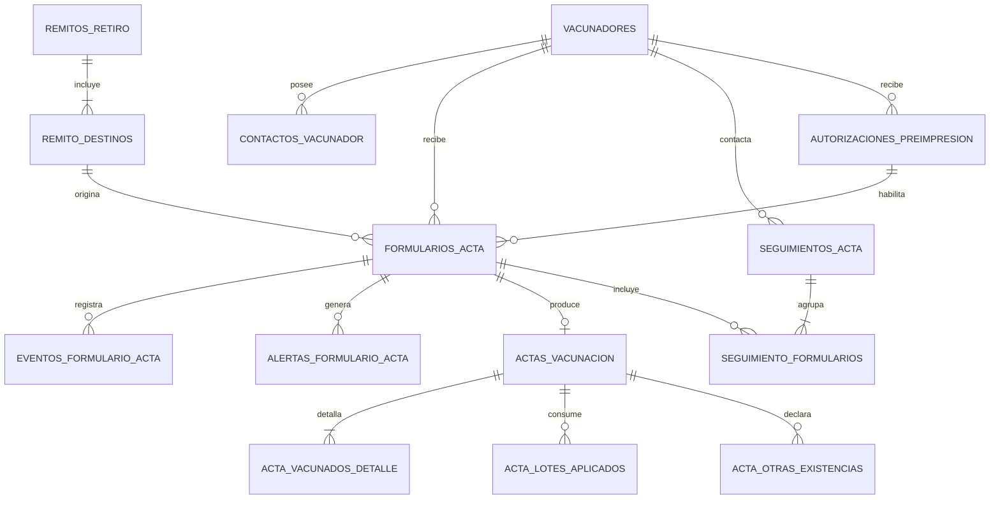

# Modelo operativo de actas, demoras y seguimiento

## Objetivo

Definir las tablas y relaciones necesarias para sostener el circuito completo:

`remito → preborrador impreso → entrega al vacunador → devolución → carga → confirmación → conciliación`

El modelo separa el control del papel, los datos sanitarios cargados y las comunicaciones de seguimiento. Esta separación permite saber qué documento se entregó aunque todavía no exista una vacunación confirmada.

La numeración definitiva de las actas continúa postergada. El diseño admite un identificador provisional y un número visible opcional hasta resolver ese tema.

## Relación general

## 1. Vacunadores y contactos

### `vacunadores`

Representa a la persona responsable de retirar vacuna, recibir los juegos y devolverlos.

| Campo | Regla |
|---|---|
| `id` | Clave interna. |
| `matricula` | Identificador profesional; único cuando corresponda. |
| `nombre` | Nombre completo. |
| `tipo` | Veterinario o idóneo, según catálogo vigente. |
| `estado` | Activo, suspendido o inactivo. |
| `vigente_desde`, `vigente_hasta` | Período de habilitación. |

El estado profesional y el bloqueo por demora son conceptos distintos. Un vacunador puede estar habilitado profesionalmente y, al mismo tiempo, bloqueado para nuevas preimpresiones por actas pendientes.

### `contactos_vacunador`

Permite conservar varios teléfonos u otros medios sin sobrescribir la historia.

| Campo | Regla |
|---|---|
| `id` | Clave interna. |
| `vacunador_id` | Referencia obligatoria a `vacunadores`. |
| `tipo` | Móvil, fijo, correo u otro. |
| `valor_original` | Valor ingresado o importado. |
| `valor_normalizado` | Para móviles, formato internacional E.164. |
| `es_preferido` | Solo uno preferido por tipo y período. |
| `autoriza_avisos` | Habilita comunicaciones operativas. |
| `habilita_whatsapp` | Solo para un móvil validado y autorizado. |
| `verificado_en` | Fecha de comprobación; vacío si no fue validado. |
| `vigente_desde`, `vigente_hasta` | Historia del contacto. |

El teléfono histórico importado desde Access ingresa sin verificar. No habilita automáticamente WhatsApp. Estos datos son privados y no se imprimen en actas ni remitos.

## 2. Destino del remito

### `remito_destinos`

Continúa siendo la unión entre un retiro y cada productor/establecimiento previsto. Campos relevantes para actas:

| Campo | Regla |
|---|---|
| `id` | Clave interna. |
| `remito_id` | Remito que entrega la vacuna. |
| `cliente_productor_id` | Cliente/productor canónico. |
| `padron_campania_id` | Fila SENASA vinculada y resuelta. |
| `establecimiento_id` | Predio de vacunación. |
| `dosis_previstas` | Estimación logística; no representa vacunación. |
| `estado` | Activo o anulado con motivo. |

Un destino puede originar más de un formulario por vacunaciones parciales. Cada formulario se genera expresamente; nunca por el solo hecho de que sobren dosis.

## 3. Control del formulario físico

### `formularios_acta`

Es el registro central de cada juego por triplicado.

| Campo | Regla |
|---|---|
| `id` | Clave interna, estable y no visible. |
| `numero_visible` | Opcional hasta definir la numeración; único dentro del ámbito que se establezca. |
| `identificador_provisional` | Visible mientras no exista número definitivo. |
| `remito_destino_id` | Destino que originó el juego. |
| `vacunador_id` | Responsable al que se entrega. |
| `centro_id` | Centro que controla el documento. |
| `campania_id` | Campaña correspondiente. |
| `plantilla_id` | Versión del formato utilizado. |
| `lote_impresion_id` | Emisión a la que pertenece, cuando se implemente. |
| `estado_documental` | Estado del papel. |
| `estado_carga` | Estado de su transcripción digital. |
| `impreso_en` | Primera impresión válida. |
| `entregado_en` | Inicio del cómputo de demora. |
| `devuelto_en` | Regreso físico, si ocurrió. |
| `resuelto_en` | Finalización efectiva del pendiente. |
| `autorizacion_preimpresion_id` | Excepción utilizada, si existió. |
| `instantanea_impresa` | Datos estructurados e inmutables que figuraron en el papel. |
| `version` | Control de concurrencia. |

#### Estados documentales

- `PREIMPRESO`;
- `ENTREGADO`;
- `DEVUELTO`;
- `DEVUELTO_SIN_UTILIZAR`;
- `FALTANTE`;
- `ANULADO`.

#### Estados de carga

- `PENDIENTE`;
- `BORRADOR`;
- `OBSERVADO`;
- `CONFIRMADO`;
- `RECTIFICADO`;
- `ANULADO`.

La interfaz combina ambos estados para mostrar etiquetas sencillas. No deben mezclarse en una sola columna: un papel puede haber regresado y la carga digital seguir observada.

`resuelto_en` solo se completa cuando el formulario queda confirmado, devuelto sin utilizar o anulado mediante un procedimiento autorizado. Guardar un borrador, marcarlo observado o declarar que está faltante no resuelve la demora.

### `eventos_formulario_acta`

Historial inmutable de todo cambio documental.

| Campo | Regla |
|---|---|
| `id` | Clave interna. |
| `formulario_id` | Formulario afectado. |
| `tipo` | Impresión, reimpresión, entrega, devolución, extravío, resolución o anulación. |
| `estado_anterior`, `estado_nuevo` | Transición realizada. |
| `ocurrido_en` | Fecha y hora operativa. |
| `usuario_id` | Usuario responsable. |
| `centro_id` | Centro desde el cual se actuó. |
| `motivo` | Obligatorio en excepciones, anulaciones y correcciones. |
| `detalle` | Metadatos estructurados del evento. |

La fecha de entrega utilizada para la mora proviene del evento de entrega vigente y también queda reflejada en `formularios_acta.entregado_en` para consulta eficiente.

## 4. Vacunación transcrita

### `actas_vacunacion`

Existe como máximo una por formulario físico.

| Campo | Regla |
|---|---|
| `id` | Clave interna. |
| `formulario_id` | Referencia única y obligatoria. |
| `fecha_efectiva`, `lugar` | Datos escritos durante la visita. |
| `alcance` | Total o parcial. |
| `resultado` | Vacunación realizada o motivo de no vacunación. |
| `vacunador_efectivo_id` | Puede diferir del previsto con autorización. |
| `observaciones` | Transcripción y aclaraciones. |
| `estado` | Borrador, observada, confirmada, rectificada o anulada. |
| `creada_por`, `creada_en` | Auditoría privada. |
| `confirmada_por`, `confirmada_en` | Auditoría privada. |
| `version` | Evita confirmaciones concurrentes. |

Firmas y DNI se completan solamente en papel y no forman parte de esta tabla.

### `acta_vacunados_detalle`

Una línea por categoría bovina o bubalina efectivamente vacunada.

| Campo | Regla |
|---|---|
| `acta_id` | Acta correspondiente. |
| `categoria_animal_id` | Categoría configurada para la campaña. |
| `cantidad` | Entero no negativo. |
| `es_excepcion` | Indica una categoría o cantidad excepcional. |
| `motivo_excepcion` | Obligatorio cuando existe excepción. |
| `autorizada_por` | Usuario habilitado, cuando corresponda. |

La combinación `acta_id + categoria_animal_id` no se repite.

### `acta_lotes_aplicados`

Distribuye las dosis vacunadas entre los lotes retirados.

| Campo | Regla |
|---|---|
| `acta_id` | Acta correspondiente. |
| `remito_detalle_id` | Línea del retiro que mantiene la custodia. |
| `lote_vacuna_id` | Lote aplicado. |
| `dosis_aplicadas` | Entero positivo. |
| `es_correccion` | Señala diferencia respecto de lo preimpreso. |
| `motivo_correccion` | Obligatorio si cambia el lote previsto. |

Al confirmar, la suma de `dosis_aplicadas` debe coincidir con el total bovino/bubalino vacunado y no superar las dosis todavía explicables por el remito.

### `acta_otras_existencias`

Registra manualmente las existencias de otras especies declaradas en el papel.

| Campo | Regla |
|---|---|
| `acta_id` | Acta correspondiente. |
| `categoria_animal_id` | Ovinos, porcinos, caprinos, equinos u otras. |
| `cantidad` | Entero no negativo. |

Estas cantidades no consumen vacuna antiaftosa.

## 5. Alertas por demora

### `alertas_formulario_acta`

Registra cada alerta emitida sin alterar el estado sanitario.

| Campo | Regla |
|---|---|
| `id` | Clave interna. |
| `formulario_id` | Formulario pendiente. |
| `tipo` | Preventiva día 5 o crítica día 8. |
| `generada_en` | Fecha y hora. |
| `atendida_en`, `atendida_por` | Atención operativa, no resolución. |
| `repetir_desde` | Próxima aparición prevista. |
| `estado` | Activa, atendida o cerrada automáticamente. |

Una restricción única por formulario, tipo y ciclo impide duplicar alertas si el proceso automático se ejecuta más de una vez.

## 6. Seguimientos

### `seguimientos_acta`

Una gestión puede referirse a varias actas del mismo vacunador, por ejemplo una llamada para reclamar dos formularios demorados.

| Campo | Regla |
|---|---|
| `id` | Clave interna. |
| `vacunador_id` | Persona contactada. |
| `centro_id` | Centro responsable. |
| `contacto_id` | Teléfono o medio utilizado, cuando corresponda. |
| `canal` | Llamada, WhatsApp, correo, aviso personal u otro. |
| `resultado` | Contactado, sin respuesta, compromiso de entrega u otro catálogo. |
| `nota` | Detalle operativo privado. |
| `proximo_seguimiento_en` | Nueva fecha prevista. |
| `realizado_por`, `realizado_en` | Usuario y momento de la gestión. |
| `enlace_externo_abierto_en` | Momento en que se abrió WhatsApp, si se utilizó. |

Abrir WhatsApp no completa automáticamente `resultado`. El operador debe registrar qué ocurrió; sin una integración oficial no se afirma envío, entrega ni lectura.

### `seguimiento_formularios`

Tabla intermedia que vincula una gestión con una o varias actas.

| Campo | Regla |
|---|---|
| `seguimiento_id` | Gestión realizada. |
| `formulario_id` | Formulario reclamado. |

La combinación de ambos campos es única.

## 7. Bloqueo y autorización excepcional

### Regla calculada

No existe una tabla ni una casilla `vacunador_bloqueado`. El servidor considera bloqueado para preimpresión a un vacunador cuando existe al menos un formulario que cumple simultáneamente:

1. fue entregado a ese vacunador;
2. todavía no tiene `resuelto_en`;
3. la fecha actual se encuentra desde el comienzo del día 8 posterior a la entrega;
4. el formulario y su entrega no fueron revertidos legítimamente.

El resultado se calcula para cada intento de generar o imprimir. Resolver la última acta demorada libera automáticamente al vacunador.

### `autorizaciones_preimpresion`

Permite una excepción limitada sin apagar el control de mora.

| Campo | Regla |
|---|---|
| `id` | Clave interna. |
| `vacunador_id` | Vacunador bloqueado. |
| `remito_id` | Remito específico autorizado. |
| `motivo` | Obligatorio. |
| `cantidad_maxima_formularios` | Límite de nuevos juegos. |
| `valida_desde`, `valida_hasta` | Vigencia breve. |
| `estado` | Vigente, agotada, vencida o revocada. |
| `autorizada_por`, `autorizada_en` | Perfil habilitado y momento. |

Cada formulario generado por excepción referencia esta autorización. La cantidad utilizada se cuenta desde esos formularios; no se mantiene un contador editable que pueda desincronizarse.

## 8. Operaciones atómicas

### Generar una preimpresión

En una única transacción el servidor:

1. valida usuario, centro, campaña, remito, destino y vacunador;
2. vuelve a calcular la mora del vacunador;
3. si está bloqueado, valida una autorización vigente y con cupo;
4. crea el formulario y su instantánea;
5. registra la impresión y el evento;
6. vincula la autorización utilizada, cuando corresponda.

Dos operadores simultáneos no pueden exceder el cupo de una autorización.

### Confirmar una carga

En una única transacción:

1. bloquea la versión del formulario y del acta;
2. valida categorías, lotes y dosis;
3. confirma el acta;
4. imputa las dosis dentro de la custodia del remito;
5. actualiza cobertura y conciliación;
6. marca el formulario como resuelto;
7. cierra sus alertas activas;
8. recalcula de forma natural el bloqueo del vacunador.

No se vuelve a descontar el stock físico del centro, porque la salida ocurrió al entregar el remito.

## 9. Índices y restricciones importantes

- índice único de `actas_vacunacion.formulario_id`;
- índice por `formularios_acta(vacunador_id, resuelto_en, entregado_en)` para calcular demoras;
- índice por centro, campaña y estados para la bandeja;
- índice por número visible y por identificador provisional;
- índice por remito destino;
- índice por próxima fecha de seguimiento;
- unicidad de contactos preferidos vigentes por vacunador y tipo;
- cantidades siempre enteras y no negativas;
- ninguna fecha de resolución anterior a la entrega;
- toda transición inválida se rechaza en el servidor, aunque la interfaz no ofrezca el botón.

## 10. Privacidad y permisos

Los teléfonos, notas de seguimiento, usuarios técnicos, autorizaciones e historial detallado son privados.

Permisos independientes:

- consultar actas del centro;
- cargar borradores;
- confirmar actas;
- registrar seguimientos;
- visualizar contactos;
- abrir aviso por WhatsApp;
- autorizar una preimpresión excepcional;
- rectificar o anular;
- consultar auditoría completa.

Un usuario de subcentro solo opera formularios y contactos necesarios para su centro. La interfaz no debe exponer teléfonos completos en listados generales; se muestran enmascarados hasta iniciar una acción autorizada.

## Decisiones que permanecen pendientes

1. Regla definitiva de numeración y rangos de actas.
2. Qué perfiles, entre los dos usuarios principales, podrán autorizar excepciones de preimpresión.
3. Plazo máximo y cantidad máxima permitida por excepción.
4. Si el aviso por WhatsApp será solo asistido o utilizará WhatsApp Business en una etapa posterior.
5. Catálogo final de resultados de seguimiento.

La presentación de los acumulados personales y documentales se define en la [ficha operativa del vacunador](pantalla-ficha-vacunador.md).
